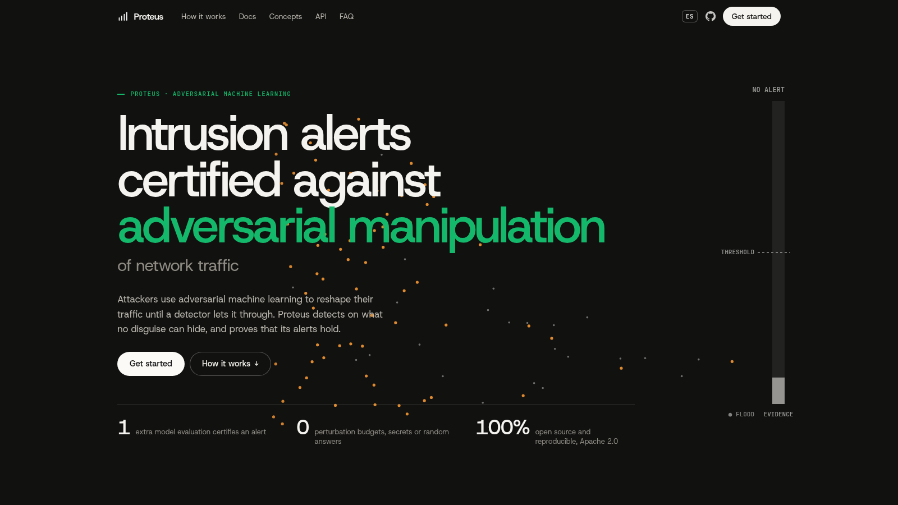

<p align="center">
  
</p>

<h1 align="center">Proteus</h1>

<p align="center">
  <b>Detección de intrusiones en red monótona sobre evidencia conservada del tráfico, con alertas certificadas</b>
</p>

<p align="center">
  <a href="https://github.com/antoniopaya22/proteus/actions/workflows/ci.yml"></a>
  <a href="https://antoniopaya22.github.io/proteus/es/"></a>
  
  
  <a href="LICENSE"></a>
</p>

<p align="center">
  <a href="https://antoniopaya22.github.io/proteus/es/">Documentación</a> ·
  <a href="https://antoniopaya22.github.io/proteus/es/getting-started/quickstart/">Inicio rápido</a> ·
  <a href="https://antoniopaya22.github.io/proteus/es/concepts/">Conceptos</a> ·
  <a href="https://antoniopaya22.github.io/proteus/es/guide/reproduce/">Reproducir</a> ·
  <a href="README.md">English</a>
</p>

<p align="center">
  <a href="https://antoniopaya22.github.io/proteus/"></a>
</p>

---

Sucesor de [Apollon](https://doi.org/10.1016/j.cose.2023.103546): detección de
intrusiones en red robusta frente a la evasión adversaria. En lugar de ocultar qué
modelo responde, Proteus detecta sobre **evidencia conservada**: contadores por entidad
que las operaciones gratuitas del atacante (relleno, paquetes insertados, conexiones
partidas, señuelos, puertos de origen nuevos) solo pueden aumentar. Un **núcleo
monótono** puntúa esa evidencia, así que la manipulación aditiva no puede bajar su
puntuación, y una alerta que aguanta una holgura fijada por el exportador de flujos
queda **certificada**, bajo supuestos declarados sobre el exportador, frente a
cualquier combinación de esas operaciones con una sola evaluación más del modelo. El
certificado es estrecho (en el paper cubre alertas en 10 de 24 campañas volumétricas y
escaneos al presupuesto de alarmas, y ninguna en las capturas con tráfico de fondo
real); lo que le queda al atacante, ir más despacio, desde más orígenes o con
peticiones más pequeñas, se mide como la **frontera de daño**.

El paper está en preparación. La documentación completa, en inglés y en español, está en
**https://antoniopaya22.github.io/proteus/es/**.

## Instalación

Python ≥ 3.11 (los experimentos usaron 3.12.3).

```sh
uv sync --frozen --extra dev --extra attacks --extra packets   # versiones exactas del paper (uv.lock)
uv run pytest                                     # unos 290 tests, cinco minutos
```

Sin el fichero de bloqueo: `uv venv && uv pip install -e ".[dev,attacks,packets]"` (ART
solo hace falta para los ataques a la capa por flujo; dpkt y NFStream, para las capturas
de paquetes).

Versiones usadas en el paper: numpy 2.5.4, pandas 3.1.1, scikit-learn 1.9.1, scipy
1.18.1, numba 0.68.1, pyarrow 26.0.1, adversarial-robustness-toolbox 1.20.1, dpkt 1.9.8,
nfstream 6.6.0.

## Línea de órdenes

Cada experimento es una orden (`proteus <orden> --help` para sus opciones):

```sh
proteus --help                                    # lista de órdenes
python examples/certificate.py                    # certifica alertas sobre evidencia sintética
proteus prepare --dataset cicids2017 --raw data/raw/cicids2017 --out data/processed/cicids2017
PROTEUS_EVIDENCE=v3 proteus detect --train csecicids2018 --test cicids2017 --models proteus proteus_cert
```

## Datos

Los datasets no se versionan. Cómo descargarlos y convertirlos está en
[`data/README.md`](data/README.md) y en la
[guía de datasets](https://antoniopaya22.github.io/proteus/es/guide/datasets/).

| Dataset | Uso | Origen |
|---|---|---|
| CIC-IDS-2017 y CSE-CIC-IDS-2018 corregidos (Liu et al., CNS 2022) | detección entre redes, fronteras, ataques | [distrinet](https://intrusion-detection.distrinet-research.be/CNS2022/Datasets/) |
| pcap del viernes de CIC-IDS-2017 | comprobación del certificado sobre paquetes | CIC (formulario de descarga) |
| CTU-13 | tráfico real con fondo sin etiquetar | Stratosphere Lab (CTU) |
| UGR'16 | tráfico real de un ISP con ataques inyectados | ver `data/README.md` |
| CIC-DDoS-2019 | comprobación de la detección en inundaciones por reflexión y SYN | ver `data/README.md` |

## Reproducir los experimentos

`scripts/reproduce.sh` ejecuta cada experimento con sus parámetros exactos, etapa a
etapa; `scripts/paper_tables.sh` regenera después las tablas y los datos de las figuras
en `experiments/outputs/paper_tables/`.

```sh
bash scripts/reproduce.sh data        # convierte los datasets (una vez)
bash scripts/reproduce.sh h1 tables   # detección entre redes y, después, tablas
bash scripts/reproduce.sh all         # todo, en orden
```

Cada etapa, con lo que produce y la memoria y el tiempo que necesita, está descrita en
la [guía de reproducción](https://antoniopaya22.github.io/proteus/es/guide/reproduce/).
Los experimentos se ejecutaron en una AWS c6a.4xlarge (16 vCPU, 32 GB de RAM, sin GPU);
las ejecuciones que evalúan sobre CSE-CIC-IDS-2018 llegan a 16–18 GB, así que no lances
dos a la vez con 32 GB.

**Determinismo.** Semillas fijas; los umbrales se calibran solo con tráfico benigno de
la red de prueba (otros días), sin etiquetas de ataque.

**Variables de entorno.** `PROTEUS_EVIDENCE` (`v1` por defecto; `v3` para Proteus y
Proteus-cert), `PROTEUS_TIMER_S` (periodo de repuntuación δ en la holgura del
certificado), `PROTEUS_PEER` y `PROTEUS_PAIRBASE` (líneas base experimentales de
población y de pares).

## Estructura

| Carpeta | Contenido |
|---|---|
| `src/proteus/datasets` | Lectores y conversión a Parquet (CIC, CTU-13, UNSW-NB15, UGR'16, CIC-DDoS-2019, CTU-SME-11) |
| `src/proteus/evidence` | Contadores decaídos por entidad y líneas base por entidad |
| `src/proteus/core` | Monotonía, certificado, máximo calibrado, frontera, explicaciones, reglas, envenenamiento |
| `src/proteus/packets` | Lectura de pcap, exportador de flujos y operaciones gratuitas sobre paquetes |
| `src/proteus/shell` | Capa por flujo |
| `src/proteus/attacks` | Operaciones del atacante sobre registros de flujo |
| `src/proteus/baselines` | Apollon, reglas de tasa, KitNET, suavizado aleatorio |
| `src/proteus/evaluation` | Experimentos (`h1`, `frontier_exp`, `adaptive`, `poisoning`, `packet_check`, …) y tablas |
| `tests/` | Tests, incluidas las propiedades en las que se apoya la garantía |
| `examples/` | Ejemplos ejecutables (sin datasets) |
| `scripts/` | `reproduce.sh` y `paper_tables.sh` |
| `website/` | Web de documentación (MkDocs Material, inglés y español) |
| `docs/` | Notas de investigación (en español): trabajo relacionado, diseño, plan y registro de resultados |
| `experiments/outputs/` | Resultados (CSV/JSON), sin versionar |

## Cita

> A. Payá González, S. Arroni del Riego. Proteus: Monotone Network Intrusion Detection
> with Alerts Certified against Additive Traffic Manipulation. Manuscrito en preparación,
> 2026.

## Contribuir

Consulta [CONTRIBUTING.md](CONTRIBUTING.md).

## Licencia

[Apache License 2.0](LICENSE).
