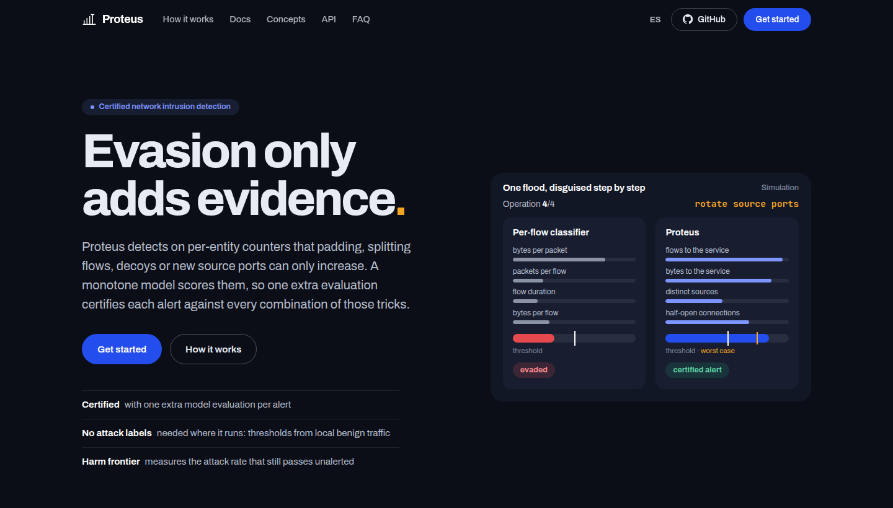

<p align="center">
  
</p>

<h1 align="center">Proteus</h1>

<p align="center">
  <b>Detección de intrusiones en red certificada a partir de evidencia conservada del tráfico</b>
</p>

<p align="center">
  <a href="https://github.com/antoniopaya22/proteus/actions/workflows/ci.yml"></a>
  <a href="https://antoniopaya22.github.io/proteus/es/"></a>
  
  
  <a href="LICENSE"></a>
</p>

<p align="center">
  <a href="https://antoniopaya22.github.io/proteus/es/">Documentación</a> ·
  <a href="https://antoniopaya22.github.io/proteus/es/getting-started/quickstart/">Inicio rápido</a> ·
  <a href="https://antoniopaya22.github.io/proteus/es/concepts/">Conceptos</a> ·
  <a href="https://antoniopaya22.github.io/proteus/es/guide/reproduce/">Reproducir</a> ·
  <a href="README.md">English</a>
</p>

<p align="center">
  <a href="https://antoniopaya22.github.io/proteus/es/"></a>
</p>

---

Sucesor de [Apollon](https://doi.org/10.1016/j.cose.2023.103546): detección de
intrusiones en red robusta frente a evasión adversaria. En lugar de ocultar qué modelo
responde, Proteus detecta sobre **evidencia conservada**: contadores por entidad que
las operaciones gratuitas del atacante (relleno, paquetes añadidos, partir conexiones,
señuelos, cambiar el puerto origen) solo pueden aumentar. Lo hace con un **núcleo
monótono** en esa evidencia. Cada alerta se **certifica** frente a cualquier
combinación de esas operaciones con una sola evaluación más del modelo, y lo que le
queda al atacante (ir más despacio) se mide como **frontera de daño**.

El artículo está en preparación. Documentación completa, en inglés y español, en
**https://antoniopaya22.github.io/proteus/es/**.

## Instalación

Python ≥ 3.11 (los experimentos se hicieron con 3.12.3).

```sh
uv venv && uv pip install -e ".[dev]"            # núcleo y tests
uv pip install -e ".[attacks,packets]"            # ART (ataques a la cáscara) y dpkt (pcap)
uv run pytest                                     # unos 120 tests, < 1 min
```

Versiones usadas en el paper: numpy 2.5.4, pandas 3.1.1, scikit-learn 1.9.1, scipy
1.18.1, numba 0.68.1, pyarrow 26.0.1, adversarial-robustness-toolbox 1.20.1, dpkt
1.9.8.

## Línea de comandos

Cada experimento es una orden (`proteus <orden> --help` muestra sus opciones):

```sh
proteus --help                                    # lista de órdenes
python examples/certificate.py                    # certificar alertas sobre evidencia sintética
proteus prepare --dataset cicids2017 --raw data/raw/cicids2017 --out data/processed/cicids2017
PROTEUS_EVIDENCE=v3 proteus detect --train csecicids2018 --test cicids2017 --models proteus proteus_cert
```

## Datos

Los datasets no se versionan. Cómo descargarlos y convertirlos está en
[`data/README.md`](data/README.md). Resumen:

| Dataset | Uso en el paper | Origen |
|---|---|---|
| CIC-IDS-2017 y CSE-CIC-IDS-2018 corregidos (Liu et al., CNS 2022) | detección entre redes, fronteras, ataques | [distrinet](https://intrusion-detection.distrinet-research.be/CNS2022/Datasets/) |
| pcap del viernes de CIC-IDS-2017 | comprobación del certificado con paquetes | CIC (formulario de descarga) |
| CTU-13 | tráfico real con fondo sin etiquetar | Stratosphere Lab (CTU) |
| UNSW-NB15 | atacantes de un generador | UNSW Canberra (oficial) |
| UGR'16, CIC-DDoS-2019, CTU-SME-11 | en curso | ver `data/README.md` |

## Reproducir el paper

`scripts/reproduce.sh` lanza cada experimento con sus parámetros exactos, por etapas;
`scripts/paper_tables.sh` regenera después las tablas y los datos de las figuras en
`experiments/outputs/paper_tables/`.

```sh
bash scripts/reproduce.sh data        # convertir los datasets (una vez)
bash scripts/reproduce.sh h1 tables   # detección entre redes y tablas
bash scripts/reproduce.sh all         # todo, en orden
```

| Etapa | Resultado del paper | Notas |
|---|---|---|
| `h1` | Detección entre redes (`tab:h1`, `tab:h1-1e-4`), KitNET | v3 17→18: ~1,5 h, pico ~16 GB |
| `single` | Núcleos de un solo modelo (apéndice), operaciones libres sobre campañas reales | evidencia v1 |
| `review` | Máximo sin monotonía, igual presupuesto de alarmas, holgura con temporizador | |
| `ablation` | Ablación de subnúcleos (`tab:ablation`) | |
| `packets` | Certificado sobre 1,2 M paquetes reales | necesita el pcap y `dpkt` |
| `budget` | Certificado por presupuesto (BARS) frente a operaciones libres (`tab:budget`) | |
| `frontier` | Frontera de daño (`tab:frontier`, `fig:frontier`) | |
| `adaptive` | Atacante adaptativo y robustez de la comparación de defensas | |
| `poisoning` | Envenenamiento de líneas base (`fig:poisoning`) | |
| `real` | CTU-13 y UNSW-NB15 | |
| `shell` | Ataques por consultas a detectores por flujo (`tab:aml`), contador de sondas | ART; horas |
| `cost` | Coste por etapa | un núcleo de CPU |

Máquina de los experimentos: AWS c6a.4xlarge (16 vCPU, 32 GB de RAM, sin GPU). Las
ejecuciones que evalúan sobre CSE-CIC-IDS-2018 llegan a 16–18 GB: en 32 GB no se deben
lanzar dos a la vez.

**Determinismo.** Semilla fija (`--seed 0` en los experimentos y en los generadores
de variantes; `random_state=0` en todos los modelos). Los umbrales se calibran solo con tráfico benigno de
la red de prueba (otros días), sin etiquetas de ataque. Apollon responde al azar por
diseño, así que sus respuestas varían entre ejecuciones; el paper evalúa cada ejemplo
adversario con 10 tiradas.

**Variables de entorno.** `PROTEUS_EVIDENCE` (`v1` por defecto; `v3` para Proteus y
Proteus-cert), `PROTEUS_TIMER_S` (periodo de re-puntuación δ en la holgura del
certificado), `PROTEUS_PEER` y `PROTEUS_PAIRBASE` (líneas base de población y de par
relativas al servicio, experimentales).

## Estructura

| Carpeta | Contenido |
|---|---|
| `src/proteus/datasets` | Lectores y conversión a Parquet (CIC, CTU-13, UNSW-NB15, UGR'16, CIC-DDoS-2019, CTU-SME-11) |
| `src/proteus/evidence` | Contadores con decaimiento por entidad y líneas base por entidad |
| `src/proteus/core` | Monotonía, certificado, máximo calibrado, frontera, explicaciones, reglas, envenenamiento |
| `src/proteus/packets` | Lectura de pcap, exportador de flujos y operaciones libres sobre paquetes |
| `src/proteus/shell` | Cáscara por flujo |
| `src/proteus/attacks` | Operaciones del atacante sobre registros de flujo |
| `src/proteus/baselines` | Apollon (publicado y corregido), reglas de tasa, KitNET, suavizado aleatorio |
| `src/proteus/evaluation` | Experimentos (`h1`, `frontier_exp`, `adaptive`, `poisoning`, `packet_check`, `smoothing`, `aml_feature`, …) y tablas |
| `examples/` | Ejemplos ejecutables (sin datasets) |
| `tests/` | Tests, incluidos los de las propiedades que sostienen la garantía |
| `scripts/` | `reproduce.sh` y `paper_tables.sh` |
| `website/` | Web de documentación (MkDocs Material, en inglés y español) |
| `docs/` | Análisis de Apollon, estado del arte, diseño, plan y resultados (`06`) |
| `experiments/outputs/` | Resultados (CSV/JSON), no versionados |

## Citar

> A. Payá González, S. Arroni del Riego. Proteus: Certified Network Intrusion Detection from
> Conserved Traffic Evidence. Manuscrito en preparación, 2026 (título provisional).

## Contribuir

Consulta [CONTRIBUTING.md](CONTRIBUTING.md).

## Licencia

[Apache License 2.0](LICENSE).
