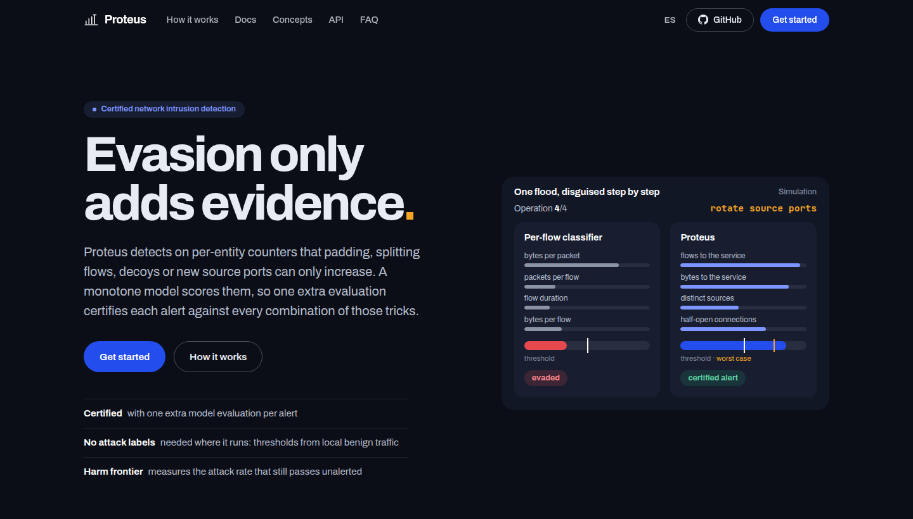

<p align="center">
  
</p>

<h1 align="center">Proteus</h1>

<p align="center">
  <b>Certified network intrusion detection from conserved traffic evidence</b>
</p>

<p align="center">
  <a href="https://github.com/antoniopaya22/proteus/actions/workflows/ci.yml"></a>
  <a href="https://antoniopaya22.github.io/proteus/"></a>
  
  
  <a href="LICENSE"></a>
</p>

<p align="center">
  <a href="https://antoniopaya22.github.io/proteus/">Documentation</a> ·
  <a href="https://antoniopaya22.github.io/proteus/getting-started/quickstart/">Quickstart</a> ·
  <a href="https://antoniopaya22.github.io/proteus/concepts/">Concepts</a> ·
  <a href="https://antoniopaya22.github.io/proteus/guide/reproduce/">Reproduce</a> ·
  <a href="README.es.md">Español</a>
</p>

<p align="center">
  <a href="https://antoniopaya22.github.io/proteus/"></a>
</p>

---

Successor of [Apollon](https://doi.org/10.1016/j.cose.2023.103546): network intrusion
detection that is robust to adversarial evasion. Instead of hiding which model answers,
Proteus detects on **conserved evidence**: per-entity counters that the attacker's free
operations (padding, inserted packets, split connections, decoys, new source ports) can
only increase. A **monotone core** scores that evidence, so every alert is **certified**
against any combination of those operations with a single extra model evaluation, and
what is left to the attacker, going slower, is measured as the **harm frontier**.

The paper is in preparation. Full documentation, in English and Spanish, at
**https://antoniopaya22.github.io/proteus/**.

## Installation

Python ≥ 3.11 (the experiments used 3.12.3).

```sh
uv venv && uv pip install -e ".[dev]"            # core and tests
uv pip install -e ".[attacks,packets]"            # ART (attacks on the shell) and dpkt (pcap)
uv run pytest                                     # about 120 tests, under a minute
```

Versions used for the paper: numpy 2.5.4, pandas 3.1.1, scikit-learn 1.9.1, scipy
1.18.1, numba 0.68.1, pyarrow 26.0.1, adversarial-robustness-toolbox 1.20.1, dpkt 1.9.8.

## Command line

Every experiment is one command (`proteus <command> --help` for its options):

```sh
proteus --help                                    # list of commands
python examples/certificate.py                    # certify alerts on synthetic evidence
proteus prepare --dataset cicids2017 --raw data/raw/cicids2017 --out data/processed/cicids2017
PROTEUS_EVIDENCE=v3 proteus detect --train csecicids2018 --test cicids2017 --models proteus proteus_cert
```

## Data

Datasets are not versioned. How to download and convert them is in
[`data/README.md`](data/README.md) and in the
[datasets guide](https://antoniopaya22.github.io/proteus/guide/datasets/).

| Dataset | Use | Source |
|---|---|---|
| Corrected CIC-IDS2017 and CSE-CIC-IDS2018 (Liu et al., CNS 2022) | detection across networks, frontiers, attacks | [distrinet](https://intrusion-detection.distrinet-research.be/CNS2022/Datasets/) |
| CIC-IDS2017 Friday pcap | checking the certificate on packets | CIC (download form) |
| CTU-13 | real traffic with an unlabelled background | Stratosphere Lab (CTU) |
| UNSW-NB15 | attackers from a traffic generator | UNSW Canberra (official) |
| UGR'16, CIC-DDoS2019, CTU-SME-11 | in progress | see `data/README.md` |

## Reproducing the experiments

`scripts/reproduce.sh` runs every experiment with its exact parameters, stage by stage;
`scripts/paper_tables.sh` then regenerates tables and figure data in
`experiments/outputs/paper_tables/`.

```sh
bash scripts/reproduce.sh data        # convert the datasets (once)
bash scripts/reproduce.sh h1 tables   # detection across networks, then tables
bash scripts/reproduce.sh all         # everything, in order
```

Every stage, with what it produces and its memory and time needs, is described in the
[reproduction guide](https://antoniopaya22.github.io/proteus/guide/reproduce/).
Experiments ran on an AWS c6a.4xlarge (16 vCPU, 32 GB RAM, no GPU); runs that evaluate
on CSE-CIC-IDS2018 reach 16–18 GB, so do not launch two at once on 32 GB.

**Determinism.** Fixed seeds; thresholds are calibrated only on benign traffic of the
test network (other days), without attack labels.

**Environment variables.** `PROTEUS_EVIDENCE` (`v1` by default; `v3` for Proteus and
Proteus-cert), `PROTEUS_TIMER_S` (re-scoring period δ in the certificate slack),
`PROTEUS_PEER` and `PROTEUS_PAIRBASE` (experimental population and pair baselines).

## Layout

| Folder | Content |
|---|---|
| `src/proteus/datasets` | Readers and conversion to Parquet (CIC, CTU-13, UNSW-NB15, UGR'16, CIC-DDoS2019, CTU-SME-11) |
| `src/proteus/evidence` | Decayed per-entity counters and per-entity baselines |
| `src/proteus/core` | Monotonicity, certificate, calibrated maximum, frontier, explanations, rules, poisoning |
| `src/proteus/packets` | pcap reading, flow exporter and free operations on packets |
| `src/proteus/shell` | Per-flow shell |
| `src/proteus/attacks` | Attacker operations on flow records |
| `src/proteus/baselines` | Apollon, rate rules, KitNET, randomised smoothing |
| `src/proteus/evaluation` | Experiments (`h1`, `frontier_exp`, `adaptive`, `poisoning`, `packet_check`, …) and tables |
| `tests/` | Tests, including the properties the guarantee rests on |
| `examples/` | Runnable examples (no dataset needed) |
| `scripts/` | `reproduce.sh` and `paper_tables.sh` |
| `website/` | Documentation website (MkDocs Material, English and Spanish) |
| `docs/` | Research notes (Spanish): analysis of Apollon, related work, design, plan and results log |
| `experiments/outputs/` | Results (CSV/JSON), not versioned |

## Citation

> A. Payá González, S. Arroni del Riego. Proteus: Certified Network Intrusion Detection
> from Conserved Traffic Evidence. Manuscript in preparation, 2026 (provisional title).

## Contributing

See [CONTRIBUTING.md](CONTRIBUTING.md).

## License

[Apache License 2.0](LICENSE).
