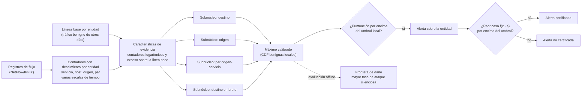

# Cómo funciona Proteus

Un detector de intrusiones convencional escucha el tráfico y clasifica cada conexión.
Proteus también escucha y clasifica, pero clasifica otra cosa: el estado de las máquinas
que cada conexión toca.

## Dos términos antes de empezar

- **Una alerta** es Proteus diciendo *esta máquina está siendo atacada ahora mismo*.
  Señala un servicio, una máquina o un origen, y lleva los marcadores que la han
  disparado, para que un analista vea por qué.
- **Una alerta certificada** es una alerta que viene con una prueba: ninguna cantidad
  de relleno, tráfico señuelo o partición de conexiones la habría evitado. Lo único que
  podría evitarla es enviar menos, y eso debilita el ataque (o, en una inundación,
  enviar peticiones más pequeñas, que el certificado no cubre).

## La idea en un minuto

- **Un detector convencional pregunta, por cada conexión: ¿esta conexión parece un
  ataque?** Todo lo que mira (duración, tamaño de los paquetes, tiempos) lo elige quien
  envía la conexión, así que un atacante puede darle la forma que haga falta hasta que
  la respuesta sea no.
- **Proteus pregunta: ¿le está pasando algo anormal a esta máquina ahora mismo?** Lleva
  la cuenta de cada servicio, máquina y origen: cuánto tráfico recibe, desde cuántos
  orígenes, cuántas conexiones quedan sin respuesta. Cada conexión solo actualiza los
  marcadores de las máquinas que implica.
- **Un atacante siempre puede enviar más, pero no puede enviar menos peticiones sin
  debilitar su ataque.** Rellenar paquetes, mandar señuelos o partir conexiones es tráfico de más,
  así que sube los marcadores. El modelo de Proteus está construido para que su
  puntuación solo pueda subir cuando un marcador sube. Por eso los disfraces no pueden
  quitar una alerta, y Proteus lo comprueba para cada alerta con una evaluación más del
  modelo: una alerta *certificada*.

## Míralo paso a paso

Pulsa *Siguiente* para seguir la historia, o mueve tú los controles. Las pestañas
muestran una inundación HTTP, un escaneo de puertos y el caso que Proteus no resuelve:
un ataque que cabe en una sola conexión.

## De un detector convencional a Proteus

| | Detector convencional | Proteus |
|---|---|---|
| Qué ve el modelo | Rasgos de una conexión | Marcadores de las máquinas implicadas |
| Sobre qué es la alerta | Una conexión | Una máquina o un servicio |
| Memoria | Ninguna entre conexiones | De segundos a horas |
| Qué controla el atacante | Casi todos los rasgos | Solo puede subir los marcadores |
| Un ataque de una conexión | Visible | Casi invisible: queda para la capa por flujo |

## Con más detalle

Proteus trabaja sobre registros de flujo (NetFlow/IPFIX). Su diseño parte de una
pregunta: *¿qué no puede cambiar un atacante sin que su ataque deje de funcionar?* Una
denegación de servicio necesita volumen sobre su víctima, un escaneo necesita tocar
muchos puertos o máquinas, un ataque de fuerza bruta necesita muchos intentos. Proteus
detecta sobre esa parte del tráfico, a la que llama **evidencia conservada**, con un
modelo que solo puede subir su puntuación cuando se añade evidencia.

## Cadena de procesamiento

1. **Evidencia conservada.** Cada registro de flujo actualiza contadores con decaimiento
   exponencial de las entidades a las que pertenece: su servicio de destino, su host de
   destino, su host de origen y su par origen–servicio. Los contadores se mantienen con
   varias constantes de tiempo, desde diez segundos hasta seis horas. Consulta
   [Evidencia conservada](conserved-evidence.md).
2. **Líneas base.** Cada entidad tiene una línea base aprendida del tráfico benigno de
   otros días de la misma red, de modo que un servidor DNS muy cargado y un servidor web
   inactivo se juzgan frente a su propio nivel normal.
3. **Núcleo monótono.** Cuatro subnúcleos, árboles con gradient boosting y
   restricciones de monotonía, puntúan la evidencia. Sus puntuaciones se transforman
   mediante su distribución sobre el tráfico benigno local y se combinan con un máximo.
   Consulta [Núcleo monótono](monotone-core.md).
4. **Alerta y certificado.** Se lanza una alerta cuando la puntuación combinada supera
   un umbral calibrado sobre el tráfico benigno local. Está *certificada* cuando la
   puntuación del peor caso sobre todas las operaciones gratuitas, una única evaluación
   adicional, sigue superándolo. Consulta [Certificado](certificate.md).
5. **Frontera de daño.** Lo que no consiguen las operaciones gratuitas puede
   conseguirlo ralentizar el ataque. La frontera de daño mide la mayor tasa de ataque
   que no lanza ninguna alerta, simple o certificada. Consulta
   [Frontera de daño](harm-frontier.md).

Las suposiciones en las que se basa todo esto, y lo que queda fuera de ellas, se
recogen en el [Modelo de amenaza](threat-model.md).

## La capa por flujo

Algunos ataques no dejan huella agregada: una única petición de explotación o una
inyección SQL en una sola conexión parecen, a nivel de flujo, una petición benigna.
Proteus los cubre con un clasificador por flujo convencional, la *capa*, que no tiene
garantía. Un despliegue puede sumar sus alertas a las del núcleo; en una red en la que
no se entrenó lanza demasiadas falsas alarmas para funcionar sin supervisión, así que
la evaluación la mide aparte y «Proteus» significa allí los dos detectores del núcleo.

La capa se acopla al núcleo en un sentido. Cuando se ejecuta en línea y bloquea un
flujo, ese flujo bloqueado se convierte en evidencia contra su origen: un recuento con
decaimiento, por origen, de las sondas bloqueadas que el atacante no puede retirar. Un
ataque por consultas que necesita muchas sondas contra la capa lanza, por tanto, una
alerta sobre su propio origen.

## Dos detectores, un sistema

| Detector | Nombre del modelo | Evidencia | Escalas de tiempo | Función |
|---|---|---|---|---|
| **Proteus-fast** | `proteus` | todos los contadores conservados | todas (de 10 s a 6 h) | Detección rápida y cobertura. Sus alertas rara vez están certificadas, porque la holgura es grande en escalas cortas. |
| **Proteus-cert** | `proteus_cert_r` | solo bytes de carga y recuentos distintos | 10 minutos o más | El suelo certificado: sus alertas certificadas resisten cualquier combinación de operaciones gratuitas y la reutilización de conexiones. |

Los dos son máximos calibrados de cuatro subnúcleos del mismo tipo, y Proteus lanza una
alerta cuando lo hace cualquiera de ellos (`proteus_pcr` en la evaluación). Fallan en
sitios distintos: la reutilización de conexiones baja los recuentos por conexión en los
que se apoya el detector rápido, y los escaneos pequeños y breves terminan antes de que
las escalas largas los noten. Como cada detector añade sus propias falsas alarmas, el
sistema se calibra a un presupuesto de alarmas y no cada miembro a su propia tasa.

El código conserva además las variantes con las que compara la evaluación:
`proteus_cert` (las escalas largas sobre todos los contadores conservados, cuyo
certificado no resiste la reutilización de conexiones) y `proteus2` (evidencia a salvo
de la reutilización en todas las escalas).

## Relación con Apollon

Proteus sucede a Apollon (Payá et al., *Computers & Security* 136, 2024), la defensa
anterior de los autores frente al aprendizaje automático adversario en la detección de
intrusiones. Apollon hacía difícil predecir qué modelo responde a cada consulta. Proteus
explora una dirección complementaria: en lugar de hacer el detector más difícil de
modelar, lo restringe a evidencia que las operaciones de evasión no pueden reducir, de
modo que la robustez se puede enunciar y comprobar para cada alerta.
