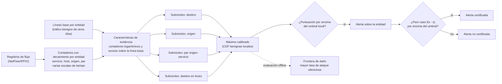

# Cómo funciona Proteus

Proteus es un sistema de detección de intrusiones en red que trabaja sobre registros de
flujo (NetFlow/IPFIX). Su diseño parte de una pregunta: *¿qué no puede cambiar un
atacante sin que su ataque deje de funcionar?* Una denegación de servicio necesita
volumen sobre su víctima, un escaneo necesita tocar muchos puertos o hosts, un ataque de
fuerza bruta necesita muchos intentos. El atacante puede añadir tráfico encima de esa
actividad, cambiarle la forma o partirla, pero no puede eliminarla sin renunciar a parte
del ataque.

Proteus detecta sobre esa parte del tráfico, a la que llama **evidencia conservada**,
con un modelo que solo puede subir su puntuación cuando se añade evidencia. En
consecuencia, las transformaciones baratas en las que se apoya un ataque de evasión no
pueden eliminar una alerta, y Proteus puede comprobarlo para cada alerta al coste de una
evaluación adicional del modelo.

## Cadena de procesamiento

1. **Evidencia conservada.** Cada registro de flujo actualiza contadores con decaimiento
   exponencial de las entidades a las que pertenece: su servicio de destino, su host de
   destino, su host de origen y su par origen–servicio. Los contadores se mantienen con
   varias constantes de tiempo, desde diez segundos hasta seis horas. Consulta
   [Evidencia conservada](conserved-evidence.md).
2. **Líneas base.** Cada entidad tiene una línea base aprendida del tráfico benigno de
   otros días de la misma red, de modo que un servidor DNS muy cargado y un servidor web
   inactivo se juzgan frente a su propio nivel normal.
3. **Núcleo monótono.** Cuatro subnúcleos, árboles con gradient boosting y
   restricciones de monotonía, puntúan la evidencia. Sus puntuaciones se transforman
   mediante su distribución sobre el tráfico benigno local y se combinan con un máximo.
   Consulta [Núcleo monótono](monotone-core.md).
4. **Alerta y certificado.** Se lanza una alerta cuando la puntuación combinada supera
   un umbral calibrado sobre el tráfico benigno local. Está *certificada* cuando la
   puntuación del peor caso sobre todas las operaciones gratuitas, una única evaluación
   adicional, sigue superándolo. Consulta [Certificado](certificate.md).
5. **Frontera de daño.** Lo que no consiguen las operaciones gratuitas puede
   conseguirlo ralentizar el ataque. La frontera de daño mide la mayor tasa de ataque
   que no lanza ninguna alerta, simple o certificada. Consulta
   [Frontera de daño](harm-frontier.md).

Las suposiciones en las que se basa todo esto, y lo que queda fuera de ellas, se
recogen en el [Modelo de amenaza](threat-model.md).

## La capa por flujo

Algunos ataques no dejan huella agregada: una única petición de explotación o una
inyección SQL en una sola conexión parecen, a nivel de flujo, una petición benigna.
Proteus los cubre con un clasificador por flujo convencional, la *capa*, que no tiene
garantía. La decisión final es la disyunción de las alertas de la capa y del núcleo.

La capa se acopla al núcleo en un sentido. Cuando se ejecuta en línea y bloquea un
flujo, ese flujo bloqueado se convierte en evidencia contra su origen: un recuento con
decaimiento, por origen, de las sondas bloqueadas que el atacante no puede retirar. Un
ataque por consultas que necesita muchas sondas contra la capa lanza, por tanto, una
alerta sobre su propio origen.

## Dos detectores, una familia de modelos

| Detector | Escalas de tiempo | Función |
|---|---|---|
| **Proteus** | todas (de 10 s a 6 h) | Detección rápida; sus alertas pueden estar certificadas o no. |
| **Proteus-cert** | 10 minutos o más | Suelo certificado: sus alertas resisten cualquier combinación de operaciones gratuitas. |

Ambos son máximos calibrados de los mismos cuatro subnúcleos. Un despliegue ejecuta los
dos: el detector de todas las escalas por rapidez y Proteus-cert como garantía.

## Relación con Apollon

Proteus sucede a Apollon (Payá et al., *Computers & Security* 136, 2024), la defensa
anterior de los autores frente al aprendizaje automático adversario en la detección de
intrusiones. Apollon hacía difícil predecir qué modelo responde a cada consulta. Proteus
explora una dirección complementaria: en lugar de hacer el detector más difícil de
modelar, lo restringe a evidencia que las operaciones de evasión no pueden reducir, de
modo que la robustez se puede enunciar y comprobar para cada alerta.
