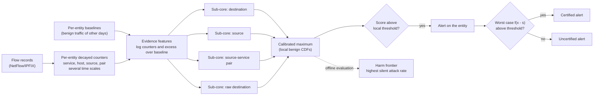

# How Proteus works

A conventional intrusion detector listens to traffic and classifies each connection.
Proteus also listens and classifies, but it classifies something else: the state of the
machines that a connection touches.

## Two terms first

- **An alert** is Proteus saying *this machine is under attack right now*. It names a
  service, a host or a source, and it carries the tallies that triggered it, so an
  analyst can see why.
- **A certified alert** is an alert that comes with a proof: no amount of padding,
  decoy traffic or connection splitting could have avoided it. The only thing that
  could is sending less, which makes the attack weaker.

## The idea in one minute

- **A conventional detector asks, for every connection: does this connection look like
  an attack?** Everything it looks at (duration, packet sizes, timing) is chosen by
  whoever sends the connection, so an attacker can reshape it until the answer is no.
- **Proteus asks: is something abnormal happening to this machine right now?** It keeps
  a tally for every service, host and source: how much traffic it receives, from how
  many sources, how many connections go unanswered. A connection only updates the
  tallies of the machines it involves.
- **An attacker can always send more, but it cannot send less without weakening the
  attack.** Padding, decoys and split connections are all extra traffic, so they raise
  the tallies. The model inside Proteus is built so that its score can only go up when
  a tally goes up. Disguises therefore cannot remove an alert, and Proteus checks this
  for each alert with one extra evaluation of the model: a *certified* alert.

## See it step by step

Press *Next* to follow the story, or move the controls yourself. The tabs show an HTTP
flood, a port scan, and the case that Proteus does not solve: an attack that fits in
one connection.

## From a conventional detector to Proteus

| | Conventional detector | Proteus |
|---|---|---|
| What the model sees | Features of one connection | Tallies of the machines involved |
| What an alert is about | A connection | A machine or a service |
| Memory | None between connections | From seconds to hours |
| What the attacker controls | Almost every feature | It can only raise the tallies |
| An attack in one connection | Visible | Almost invisible: left to the per-flow shell |

## In more detail

Proteus works on flow records (NetFlow/IPFIX). Its design starts from one question:
*what can an attacker not change without its attack ceasing to work?* A denial of
service needs volume on its victim, a scan needs to touch many ports or hosts, a brute
force needs many attempts. Proteus detects on that part of the traffic, which it calls
**conserved evidence**, with a model that can only raise its score when evidence is
added.

## Pipeline

1. **Conserved evidence.** Each flow record updates exponentially decayed counters of
   the entities it belongs to: its destination service, destination host, source host
   and source–service pair. Counters are kept at several time constants, from ten
   seconds to six hours. See [Conserved evidence](conserved-evidence.md).
2. **Baselines.** Each entity has a baseline learned from benign traffic of other days
   of the same network, so a busy DNS server and an idle web server are judged against
   their own normal level.
3. **Monotone core.** Four sub-cores, gradient-boosted trees with monotonicity
   constraints, score the evidence. Their scores are mapped through their distribution
   on local benign traffic and combined by a maximum. See
   [Monotone core](monotone-core.md).
4. **Alert and certificate.** An alert is raised when the combined score exceeds a
   threshold calibrated on local benign traffic. It is *certified* when the score of
   the worst case over all free operations, a single extra evaluation, still exceeds
   it. See [Certificate](certificate.md).
5. **Harm frontier.** What free operations cannot do, slowing down can. The harm
   frontier measures the highest attack rate that raises no alert, plain and
   certified. See [Harm frontier](harm-frontier.md).

The assumptions behind all of this, and what lies outside them, are listed in the
[Threat model](threat-model.md).

## The per-flow shell

Some attacks leave no aggregate footprint: a single exploit request or an SQL injection
in one connection looks, at the flow level, like a benign request. Proteus covers them
with a conventional per-flow classifier, the *shell*, which has no guarantee. The final
decision is the disjunction of shell and core alerts.

The shell is coupled to the core in one direction. When it runs inline and blocks a
flow, that blocked flow becomes evidence against its source: a per-source decayed count
of blocked probes that the attacker cannot take back. A query attack that needs many
probes against the shell therefore raises an alert on its own source.

## Three detectors, one model family

| Detector | Evidence | Time scales | Role |
|---|---|---|---|
| **Proteus** | every conserved counter | all (10 s to 6 h) | Fast detection; its alerts are rarely certified, because the slack is large at short scales. |
| **Proteus-cert** | every conserved counter | 10 minutes and more | Certified floor: its certified alerts survive any combination of free operations. |
| **Proteus-cert-R** | payload bytes and distinct counts only | 10 minutes and more | Its certified alerts also survive connection reuse, which lowers per-connection counts. |

All three are calibrated maxima of four sub-cores of the same kind. A deployment
combines them: the all-scale detector for timeliness and the other two as the
guarantee. Because every detector adds its own false alarms, the combination is
calibrated to an alarm budget rather than each member to its own rate.

## Relation to Apollon

Proteus succeeds Apollon (Payá et al., *Computers & Security* 136, 2024), the authors'
earlier defence against adversarial machine learning in intrusion detection. Apollon
made the model that answers each query hard to predict. Proteus explores a
complementary direction: instead of making the detector harder to model, it restricts
the detector to evidence that evasion operations cannot reduce, so that robustness can
be stated and checked per alert.
