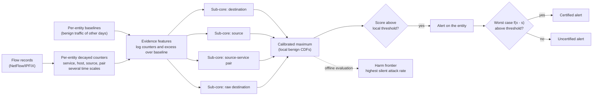

# How Proteus works

Proteus is a network intrusion detection system that works on flow records
(NetFlow/IPFIX). Its design starts from one question: *what can an attacker not
change without its attack ceasing to work?* A denial of service needs volume on its
victim, a scan needs to touch many ports or hosts, a brute force needs many attempts.
The attacker can add traffic on top of that activity, reshape it or split it, but it
cannot remove it without giving up part of the attack.

Proteus detects on that part of the traffic, which it calls **conserved evidence**,
with a model that can only raise its score when evidence is added. As a consequence,
the cheap transformations an evasion attack relies on cannot remove an alert, and
Proteus can check this for every alert at the cost of one extra model evaluation.

## Pipeline

1. **Conserved evidence.** Each flow record updates exponentially decayed counters of
   the entities it belongs to: its destination service, destination host, source host
   and source–service pair. Counters are kept at several time constants, from ten
   seconds to six hours. See [Conserved evidence](conserved-evidence.md).
2. **Baselines.** Each entity has a baseline learned from benign traffic of other days
   of the same network, so a busy DNS server and an idle web server are judged against
   their own normal level.
3. **Monotone core.** Four sub-cores, gradient-boosted trees with monotonicity
   constraints, score the evidence. Their scores are mapped through their distribution
   on local benign traffic and combined by a maximum. See
   [Monotone core](monotone-core.md).
4. **Alert and certificate.** An alert is raised when the combined score exceeds a
   threshold calibrated on local benign traffic. It is *certified* when the score of
   the worst case over all free operations, a single extra evaluation, still exceeds
   it. See [Certificate](certificate.md).
5. **Harm frontier.** What free operations cannot do, slowing down can. The harm
   frontier measures the highest attack rate that raises no alert, plain and
   certified. See [Harm frontier](harm-frontier.md).

The assumptions behind all of this, and what lies outside them, are listed in the
[Threat model](threat-model.md).

## The per-flow shell

Some attacks leave no aggregate footprint: a single exploit request or an SQL injection
in one connection looks, at the flow level, like a benign request. Proteus covers them
with a conventional per-flow classifier, the *shell*, which has no guarantee. The final
decision is the disjunction of shell and core alerts.

The shell is coupled to the core in one direction. When it runs inline and blocks a
flow, that blocked flow becomes evidence against its source: a per-source decayed count
of blocked probes that the attacker cannot take back. A query attack that needs many
probes against the shell therefore raises an alert on its own source.

## Two detectors, one model family

| Detector | Time scales | Role |
|---|---|---|
| **Proteus** | all (10 s to 6 h) | Fast detection; alerts may or may not be certified. |
| **Proteus-cert** | 10 minutes and more | Certified floor: its alerts survive any combination of free operations. |

Both are calibrated maxima of the same four sub-cores. A deployment runs both: the
all-scale detector for timeliness and Proteus-cert as the guarantee.

## Relation to Apollon

Proteus succeeds Apollon (Payá et al., *Computers & Security* 136, 2024), the authors'
earlier defence against adversarial machine learning in intrusion detection. Apollon
made the model that answers each query hard to predict. Proteus explores a
complementary direction: instead of making the detector harder to model, it restricts
the detector to evidence that evasion operations cannot reduce, so that robustness can
be stated and checked per alert.
